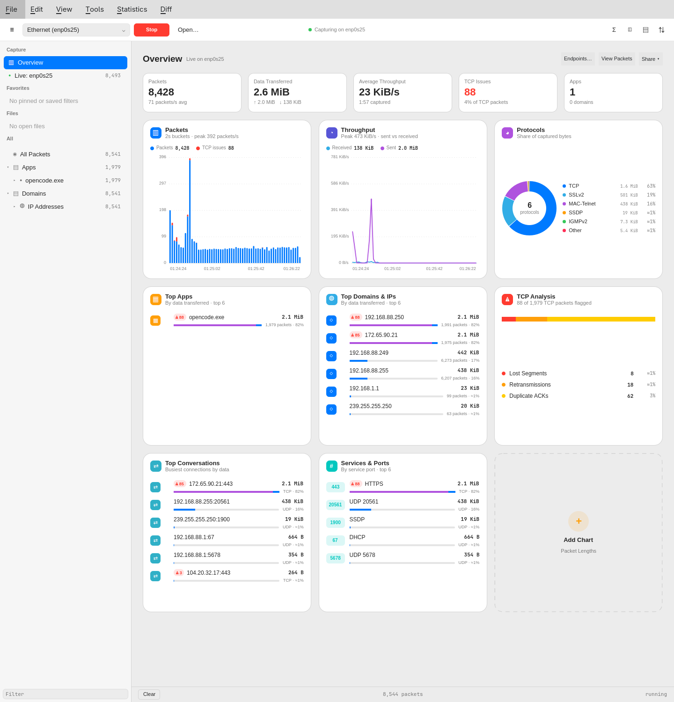
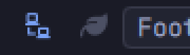
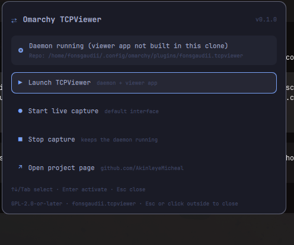

# Omarchy TCPViewer



A Linux/Omarchy port of [TCP Viewer](https://github.com/ProxymanApp/TCPViewer) by
Proxyman LLC — a native packet viewer with a live Overview dashboard, packet
table, filters, packet details, hex view, stream following, statistics and diff,
powered by Wireshark's dissection libraries.

The Overview page (shown above) opens by default: traffic totals, packets- and
bytes-per-second, protocol share, top endpoints and TCP analysis counts, all
computed from the loaded capture's buffer. Cards like *Top Domains & IPs* and
*TCP Analysis* are click-through: selecting a row applies the matching display
filter in the packet table. The **Share** header action exports the dashboard
as Markdown (Copy / Save, mirroring upstream). Data on the cover is a
sanitized synthetic capture
(10.x / 203.0.113.x addresses, `example.com` names).

## Install (Omarchy plugin)

```sh
omarchy plugin add https://github.com/AkinleyeMicheal/omarchy-tcpviewer
```

This clones the repository into the shell's plugin directory and registers
`fonsgaudii.tcpviewer` (bar widget + quick access panel). The bar widget is a
single lan-connect glyph: tinted with the accent color while the daemon is
running, muted while it is stopped.



Clicking it toggles the quick access panel — capture status plus Launch,
Start live capture, Stop capture and Open project page. While the clone has
no binaries yet, the panel shows an extra **Build engine & viewer** row that
runs `scripts/build.sh` in the background (progress and the result arrive as
desktop notifications; the log lands in `.build-logs/`). The panel is fully
keyboard-navigable: ↑↓/Tab move, Enter/Space activate, Esc closes, and the
focused row is inked with the accent border. Both scripts notify when a build
or capability is missing instead of failing silently.



Then build the viewer once inside the clone so the panel can launch it:

```sh
# Capture + dissection engine
cd <plugin-dir>/omarchy-tcpviewer/daemon && swift build

# GUI (Qt Quick)
cd .. && cmake -S app -B app/build -G Ninja -DCMAKE_BUILD_TYPE=Release
cmake --build app/build
```

Ongoing use: run `omarchy-shell -q shell toggle fonsgaudii.tcpviewer` (or click
the bar glyph) for capture status and to launch App; the app itself lives in your
application menu as **Omarchy TCPViewer** once installed (below).

For live capture, the daemon needs raw-socket access. You never have to
remember a command for it: Start-capture paths try to fix missing capabilities
automatically — they ask polkit (a desktop password dialog), use the
passwordless helper below once it is installed, or fall back to notifying you
with the exact remedy. After a rebuild, which drops file capabilities, the
panel re-grants them on the next Start (or build) the same way.

Optional one-time setup so live capture never prompts at all (installs a
root-owned, fixed-purpose helper plus a narrow polkit policy that only ever
authorizes that helper; best-effort installs the hyprpolkitagent desktop
agent):

```sh
sudo bash <plugin-dir>/omarchy-tcpviewer/scripts/setup-capture-helper.sh
```

And the manual command remains available if you ever prefer it:

```sh
sudo setcap cap_net_raw,cap_net_admin+ep \
  <plugin-dir>/omarchy-tcpviewer/daemon/.build/debug/tcpviewerd
```

Opening capture files works without capabilities. To undo the optional setup,
delete `/usr/local/libexec/omarchy-tcpviewer/` and
`/usr/share/polkit-1/actions/org.omarchy-tcpviewer.grant-caps.policy`.

### Remove

```sh
omarchy plugin remove fonsgaudii.tcpviewer --yes
```

The plugin never writes to your Hyprland/Omarchy configuration; the app
persists table/card layout in
`~/.config/omarchy-tcpviewer/Omarchy TCPViewer.conf` (Qt QSettings) and the
daemon logs to `~/.local/state/omarchy-tcpviewer/daemon.log`. Removing the
plugin leaves these and the clone's build outputs behind — delete them if you
want a full cleanup.

## System packages / external dependencies

| Dependency | Purpose | Arch package |
| --- | --- | --- |
| Qt 6.7+ (Core, Gui, Qml, Quick, QuickControls2, Network) | Desktop app | `qt6-base`, `qt6-declarative` |
| CMake + Ninja | App build system | `cmake`, `ninja` |
| C++20 compiler | App | `gcc` / `clang` (toolchain available after base-devel) |
| Swift 6.0+ toolchain | Daemon build | [swift.org](https://www.swift.org/install/linux/) (not packaged) |
| libwireshark, libwiretap, libwsutil + headers | Packet dissection (GPL) | `wireshark-cli` |
| GLib 2.0 + GObject | Wireshark library support | `glib2` |
| libpcap | Packet capture | `libpcap` |
| Quickshell | Omarchy shell plugin runtime | ships with Omarchy |

Vendored/derived upstream code (GPL-2.0-or-later): Proxyman's **TCPViewer**
capture core and Overview engine (ported as `PcapPlusPlusCore` /
`TCPViewerOverview`), their Apple-centric platform shims replaced with
Linux equivalents; plus one vendored file from Wireshark's `ipaddr`
(`daemon/vendor/ipaddr/ipaddr.c`). See [NOTICE](NOTICE).

## Build for development

```sh
# Daemon (capture + dissection engine)
cd daemon && swift build

# GUI
cmake -S app -B app/build -G Ninja -DCMAKE_BUILD_TYPE=Release
cmake --build app/build
```

Launch both with the repo script:

```sh
scripts/tcpviewer-run.sh
```

It starts `tcpviewerd` when it is not already answering, then opens the GUI.
A user-local install is also available:

- copy `app/build/omarchy-tcpviewer` to `~/.local/bin/`
- `packaging/omarchy-tcpviewer.desktop` belongs in
  `~/.local/share/applications/`

The daemon writes logs to `~/.local/state/omarchy-tcpviewer/daemon.log`
(rotated at 1 MiB). If live capture still reports `CAP_NET_RAW may be
required`, restart the daemon explicitly and retry:

```sh
pkill -x tcpviewerd
scripts/tcpviewer-run.sh
```

## The Overview page

Recomputed from the packet buffer on demand (per-source, revision-cached), so
it stays in sync with filters, appends and file loads:

- **Tiles** — packets, data transferred, average throughput, capture duration,
  TCP issues, apps/domains seen.
- **Packets / Throughput** — per-slot bar and rate charts; red segments mark
  slots with TCP analysis errors (retransmissions, lost segments, duplicate
  ACKs, resets).
- **Protocols / Top Apps / Top Domains & IPs / TCP Analysis** — share of
  captured bytes, attributed processes (live captures), endpoint ranking and
  issue breakdown; every row is a filter shortcut.
- **+ Add a card** — show/hide individual cards per source; persisted in QSettings.

The packet table remains one click away via the segmented
**Overview | Packets** control in the page header.

## Menus and columns

- `Ctrl+F` focuses the display filter, `Ctrl+Alt+F` the packet-detail filter,
  and `Ctrl+Shift+F` the sidebar tree filter.
- `Ctrl+K` clears packets, `Ctrl+B` toggles the sidebar, `Ctrl+Shift+I` the
  inspector, and `Ctrl+Shift+S` opens endpoint statistics.
- The header row's right-click menu shows/hides table columns and resets
  widths; widths persist across launches.
- Right-clicking a protocol-detail row in the inspector offers
  **Create Column**, adding a bounded table column backed by that field.

## Diff

Select a packet and press `Ctrl+Y` (or right-click → Diff Selected Packet) to
add it to the Diff pool; add a second packet the same way. The window compares:

- **Packet Details** as side-by-side or unified text with changed lines tinted.
- **Packet Bytes** as two hex panes with the changed range highlighted.

`F7` / `Shift+F7` jump between changed lines. `Clear` empties the pool. Detail
diffs are capped at 2000 lines per side; byte diffs trim the common prefix and
suffix before highlighting, so length changes do not mark every later byte.

## Source tree and app attribution

The sidebar mirrors upstream's packet-source tree: **All Packets → Apps** and
**Domains**, with domains and IP addresses grouped under each app. Live
captures resolve local TCP/UDP sockets to processes through `/proc` and show
the owning app in the Client column; offline files still populate the domain
tree from captured DNS/SNI data. Clicking a node filters the loaded packets
locally.

## Security

See [docs/security-review.md](docs/security-review.md). In short: the IPC
socket is `0700`/`0600` with same-UID peer checks, the app never fetches URLs
(no SSRF surface), imports are local files only, and capture-derived strings
are rendered as plain text.

## License

GPL-2.0-or-later — the upstream TCPViewer's license. See
[LICENSE](LICENSE) and [NOTICE](NOTICE).

## Credits

Built on Proxyman LLC's [TCP Viewer](https://github.com/ProxymanApp/TCPViewer)
— this port reuses their GPL-2.0-or-later source with gratitude. Wireshark
provides packet dissection.
