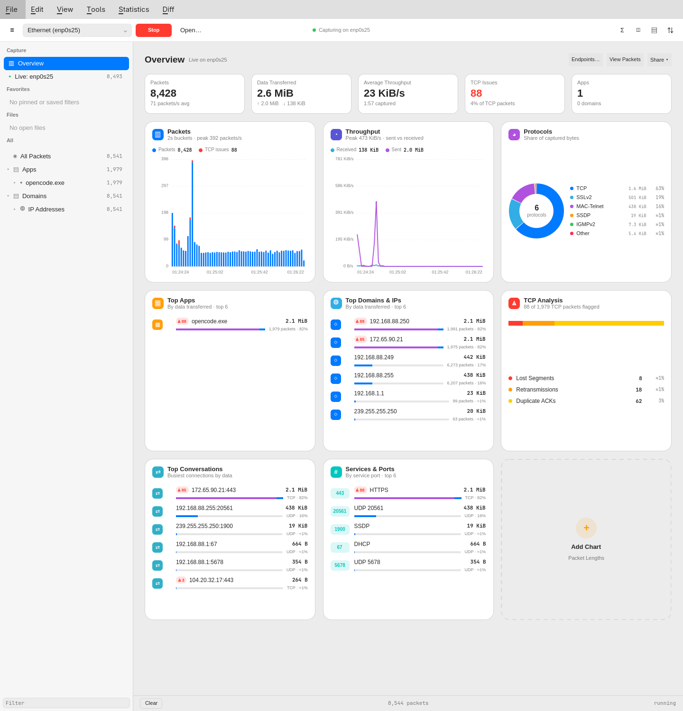
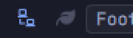
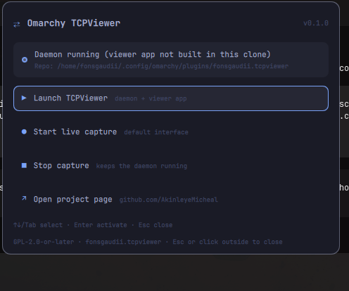
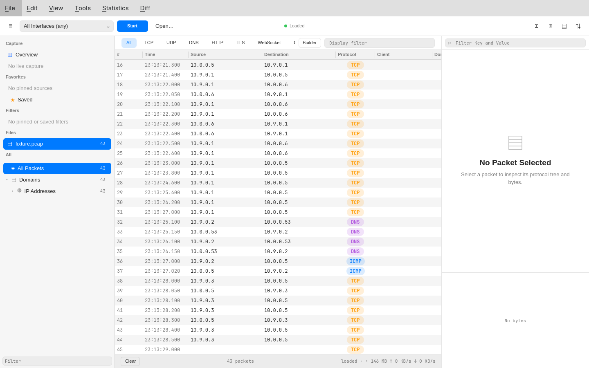
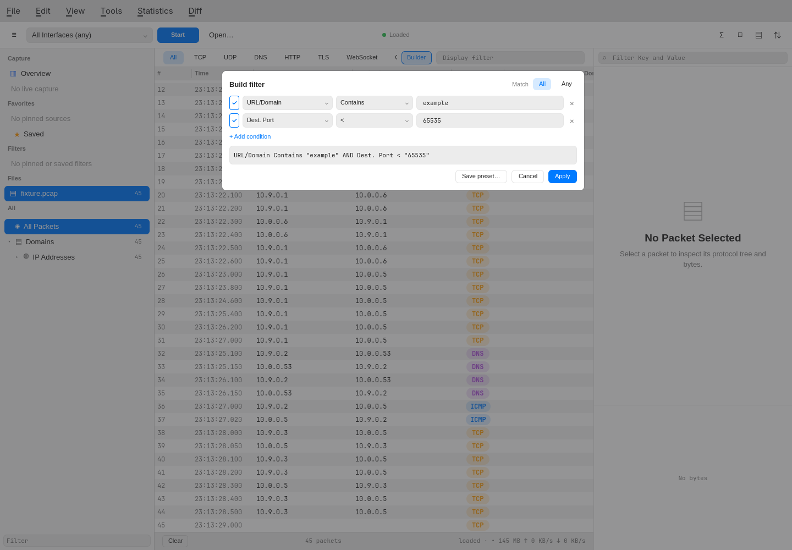

# Omarchy TCPViewer



A Linux/Omarchy port of [TCP Viewer](https://github.com/ProxymanApp/TCPViewer) by
Proxyman LLC — a native packet viewer with a live Overview dashboard, packet
table, filters, packet details, hex view, stream following, statistics and diff,
powered by Wireshark's dissection libraries.

The Overview page (shown above) opens by default: five summary tiles, then a
three-column grid of chart cards for packets, throughput, protocol share, top
apps, endpoint ranking, TCP analysis, conversations and services. Cards like
*Top Domains & IPs* and *TCP Analysis* are click-through: selecting a row
applies the matching display filter in the packet table. The **Share** header
action exports the dashboard as Markdown (Copy / Save, mirroring upstream).
The in-grid **Add Chart** cell shows or hides cards; the layout is saved across
launches. The cover is a live Ethernet capture taken after a couple of minutes of
ordinary traffic, so the dashboard shows real process attribution (Top Apps)
and endpoint ranking.

## Install (Omarchy plugin)

```sh
omarchy plugin add https://github.com/AkinleyeMicheal/omarchy-tcpviewer
```

This clones the repository into the shell's plugin directory and registers
`fonsgaudii.tcpviewer` (bar widget + quick access panel). The bar widget is a
single lan-connect glyph: tinted with the accent color while the daemon is
running, muted while it is stopped.



Clicking it toggles the quick access panel — capture status plus Launch,
Start live capture, Stop capture and Open project page. While the clone has
no binaries yet, the panel shows an extra **Build engine & viewer** row that
runs `scripts/build.sh` in the background (progress and the result arrive as
desktop notifications; the log lands in `.build-logs/`). The panel is fully
keyboard-navigable: ↑↓/Tab move, Enter/Space activate, Esc closes, and the
focused row is inked with the accent border. Both scripts notify when a build
or capability is missing instead of failing silently.



Then build the viewer once inside the clone so the panel can launch it:

```sh
# Capture + dissection engine
cd <plugin-dir>/omarchy-tcpviewer/daemon && swift build

# GUI (Qt Quick)
cd .. && cmake -S app -B app/build -G Ninja -DCMAKE_BUILD_TYPE=Release
cmake --build app/build
```

Ongoing use: run `omarchy-shell -q shell toggle fonsgaudii.tcpviewer` (or click
the bar glyph) for capture status and to launch App; the app itself lives in your
application menu as **Omarchy TCPViewer** once installed (below).

For live capture, the daemon needs raw-socket access. You never have to
remember a command for it: Start-capture paths try to fix missing capabilities
automatically — they ask polkit (a desktop password dialog), use the
passwordless helper below once it is installed, or fall back to notifying you
with the exact remedy. After a rebuild, which drops file capabilities, the
panel re-grants them on the next Start (or build) the same way.

Optional one-time setup so live capture never prompts at all (installs a
root-owned, fixed-purpose helper plus a narrow polkit policy that only ever
authorizes that helper; best-effort installs the hyprpolkitagent desktop
agent):

```sh
sudo bash <plugin-dir>/omarchy-tcpviewer/scripts/setup-capture-helper.sh
```

And the manual command remains available if you ever prefer it:

```sh
sudo setcap cap_net_raw,cap_net_admin+ep \
  <plugin-dir>/omarchy-tcpviewer/daemon/.build/debug/tcpviewerd
```

Opening capture files works without capabilities. To undo the optional setup,
delete `/usr/local/libexec/omarchy-tcpviewer/` and
`/usr/share/polkit-1/actions/org.omarchy-tcpviewer.grant-caps.policy`.

### Remove

```sh
omarchy plugin remove fonsgaudii.tcpviewer --yes
```

The plugin never writes to your Hyprland/Omarchy configuration; the app
persists table/card layout in
`~/.config/omarchy-tcpviewer/Omarchy TCPViewer.conf` (Qt QSettings) and the
daemon logs to `~/.local/state/omarchy-tcpviewer/daemon.log`. Removing the
plugin leaves these and the clone's build outputs behind — delete them if you
want a full cleanup.

## System packages / external dependencies

| Dependency | Purpose | Arch package |
| --- | --- | --- |
| Qt 6.7+ (Core, Gui, Qml, Quick, QuickControls2, Network) | Desktop app | `qt6-base`, `qt6-declarative` |
| CMake + Ninja | App build system | `cmake`, `ninja` |
| C++20 compiler | App | `gcc` / `clang` (toolchain available after base-devel) |
| Swift 6.0+ toolchain | Daemon build | [swift.org](https://www.swift.org/install/linux/) (not packaged) |
| libwireshark, libwiretap, libwsutil + headers | Packet dissection (GPL) | `wireshark-cli` |
| GLib 2.0 + GObject | Wireshark library support | `glib2` |
| libpcap | Packet capture | `libpcap` |
| zlib (system) | Session-bundle ZIP layer (`-lz`) | `zlib` (in base) |
| Quickshell | Omarchy shell plugin runtime | ships with Omarchy |

Vendored/derived upstream code (GPL-2.0-or-later): Proxyman's **TCPViewer**
capture core, Overview engine and session-bundle format (ported as
`PcapPlusPlusCore` / `TCPViewerOverview` / `TCPViewerSession`), their
Apple-centric platform shims replaced with Linux equivalents; plus one vendored
file from Wireshark's `ipaddr` (`daemon/vendor/ipaddr/ipaddr.c`). See
[NOTICE](NOTICE).

## Build for development

```sh
# Daemon (capture + dissection engine)
cd daemon && swift build

# GUI
cmake -S app -B app/build -G Ninja -DCMAKE_BUILD_TYPE=Release
cmake --build app/build
```

Launch both with the repo script:

```sh
scripts/tcpviewer-run.sh
```

It starts `tcpviewerd` when it is not already answering, then opens the GUI.
A user-local install is also available:

- copy `app/build/omarchy-tcpviewer` to `~/.local/bin/`
- `packaging/omarchy-tcpviewer.desktop` belongs in
  `~/.local/share/applications/`

The daemon writes logs to `~/.local/state/omarchy-tcpviewer/daemon.log`
(rotated at 1 MiB). If live capture still reports `CAP_NET_RAW may be
required`, restart the daemon explicitly and retry:

```sh
pkill -x tcpviewerd
scripts/tcpviewer-run.sh
```

## The Overview page

Recomputed from the packet buffer on demand (per-source, revision-cached), so
it stays in sync with filters, appends and file loads:

- **Tiles** — Packets, Data Transferred, Average Throughput, TCP Issues and
  Apps.
- **Packets / Throughput** — one-second stacked bars and rate lines with
  timestamp and numeric axes; red bar segments mark TCP analysis errors
  (retransmissions, lost segments, duplicate ACKs, resets), and the peak rate
  is shown above each chart.
- **Protocols / Top Apps / Top Domains & IPs / Top Conversations** — ranked
  split bars for sent/received bytes, packet counts, percentages and warning
  pills for TCP issues; every row is a filter shortcut.
- **TCP Analysis / Services & Ports** — a stacked issue bar with category,
  count and percentage legend; services show server port, name, transport,
  share of bytes and total bytes. *Services & Ports* is the last chart card
  before the Add Chart cell.
- **+ Add Chart** — show or hide individual cards; the picker and card order
  are persisted in QSettings. The charts are an in-repo Qt Quick Canvas layer,
  so no `qt6-charts` or KQuickCharts dependency is required.

The packet table remains one click away via the **View Packets** button in the
page header.

## Menus and columns

- `Ctrl+F` focuses the display filter, `Ctrl+Alt+F` the packet-detail filter,
  and `Ctrl+Shift+F` the sidebar tree filter.
- `Ctrl+K` clears packets, `Ctrl+B` toggles the sidebar, `Ctrl+Shift+I` the
  inspector, and `Ctrl+Shift+S` opens endpoint statistics.
- The header row's right-click menu shows/hides table columns and resets
  widths; widths persist across launches. Dragging a header reorders the
  columns (the ordered layout persists, with the Comment column pinned
  last), and `Ctrl+C` copies the selected packet row as CSV.
- The row context menu copies rows (**Copy**, **Copy Cell Value**, and
  **Copy Rows As** — Plain text, JSON, Markdown Table, CSV, CSV with
  Header) with a fixed field set that follows the visible selection, and it
  pins/saves packets next to the diff actions like the upstream menu.
  Ctrl/Shift+click builds a multi-selection that the menu (copy and
  **Export ▸ as pcap/pcapng**) targets as a whole; sidebar app, domain, and
  IP rows — and their Pinned equivalents — export their scope the same way.
- Row annotations have the upstream keyboard shortcuts (Linux uses `Ctrl`
  where upstream uses `Command`): `Ctrl+L` opens the comment sheet on the
  targeted rows, `Ctrl+1`–`Ctrl+9` apply the first nine highlight colors,
  `Ctrl+/` toggles strikethrough, and `Ctrl+0` resets the row style. The
  menu's **Delete** (or the `Del`/`Backspace` key) removes the targeted
  packet rows from the workspace — live and offline captures alike — with
  the selection hopping to the next visible row; in the Saved workspace the
  same key deletes the saved record without touching the capture.


- Right-clicking a protocol-detail row in the inspector offers
  **Create Column**, adding a bounded table column backed by that field.

## Live capture

- **Interfaces** — the picker lists every capturable device, first among them
  the synthesized **All Interfaces (any)** row, libpcap's every-interface
  device (SLL frames, loopback included). Linux cooked captures are decoded
  in full — SLL and SLL2 frames get real endpoints, ports, TCP analysis and
  process attribution, so the table columns and Overview cards carry the
  same data as per-interface captures. The picker locks while a capture
  is running; stop before switching.
- **Start / Stop / Pause / Resume** — Start and Stop are the always-visible
  controls; **Pause / Resume** appears (in the phase color) only while a
  capture runs or is paused. Pausing freezes the packet list in place —
  nothing is appended, nothing is lost.
- **BPF capture filter** — a capture start can carry a BPF expression
  (`capture start --interface IFACE --bpf EXPR` in the CLI; agents likewise).
  While one is active the toolbar shows the warning-colored ≡ indicator that
  opens a read-only popover with the expression — matching upstream, where
  editing the capture filter belongs to the CLI/MCP and the app only
  displays it. Invalid expressions are rejected through libpcap before the
  capture starts.
- **Status strip** — the right edge of the footer shows the capture phase,
  drop count, memory use, and upload/download speed (`running · 154 MB ↑
  1 KB/s ↓ 890 KB/s`). Memory is the daemon's own footprint; the byte rates
  cover remote traffic only — local-to-local packets (loopback included)
  stay uncounted, matching upstream's direction accounting.

## Filters

- **Quick filters** — the chip row above the table narrows every request (TCP,
  UDP, DNS, HTTP, TLS, WebSocket, Client/Server Hello, Errors). Chip
  predicates are evaluated by the daemon per request and stack on top of the
  display filter.
- **Display filter** — the field on the right accepts Wireshark syntax
  (`tcp.port == 80`, `http.host contains "example.com"`); Enter applies it and
  the × clears it. A bad expression refuses the apply, marks the field red
  with the message as a tooltip and selects the offending text (the same
  byte span Wireshark reports), keeping the last valid filter in effect
  while you edit.
- **Builder** — the semantic row editor behind the **Builder** chip: up to
  five field/condition/value rows joined with AND or OR, evaluated by the
  daemon per packet. Eighteen fields (URL/domain, addresses, ports, client
  process, PID, stream, TCP flags/payload, direction, interface, length,
  decode status, summary, tags…) meet ten conditions — contains/not-contains,
  prefix/suffix pairs, `<` and `>=` on numeric fields, and
  regex/not-regex. Each row has an enable checkbox (inactive rows are dimmed
  and contribute nothing), the preview reads like sentences instead of a
  compiled expression, and **Save preset…** stores the current rows in the
  sidebar like a display filter.
- **Favorites** — pin the current expression with ☆ or save it under a name
  with ⊕; **Save preset…** inside the builder saves its rows the same way.
  The sidebar's **Filters** group keeps them apart: **Pinned Expressions**
  and **Saved Wireshark** (one-click display filters) versus **Builder
  Presets** (clicking one restores its rows into the builder). The row's ×
  removes them.
- **Pinned sources & Saved packets** — hover a domain or IP row in the
  source tree for a pin flag, or right-click a packet and choose **Pin** to
  pin its client; pinned rows scope the table with one click. **Save** on a
  packet row copies it into the **Saved** workspace, where comments and
  highlights survive closing (and even deleting) the source. Both persist
  in QSettings across launches; pins and saved packets carried inside a
  `.tcpviewsession` document replace the lists while that session is open.



## Session files

Captures can be saved as a `.tcpviewsession` bundle (**Export Session** in the
toolbar / `file.export_session` in the CLI) and reopened later — the file
carries the packets, the backing pcapng, annotations (comments and highlight
colors), client records and workspace state, mirroring upstream TCP Viewer's
session format. Pins and saved packets stored in the document appear while
that session is open (Saved shows the document's records instead of your
own list, and both never outlive the session), and exporting a session
writes the currently active pin/saved lists back into the bundle — saved
references are trimmed to packets the capture still holds, matching
upstream's import sweep. Sessions are read-only once saved: export packets
or create a new session instead of re-saving. A session opens by itself —
it cannot be merged with other capture files in one import. The format is
byte-compatible with the macOS app, so files interchange both ways.

## Diff

Select a packet and press `Ctrl+Y` (or right-click → Diff Selected Packet) to
add it to the Diff pool; add a second packet the same way. The window compares:

- **Packet Details** as side-by-side or unified text with changed lines tinted.
- **Packet Bytes** as two hex panes with the changed range highlighted.

`F7` / `Shift+F7` jump between changed lines. `Clear` empties the pool. Detail
diffs are capped at 2000 lines per side; byte diffs trim the common prefix and
suffix before highlighting, so length changes do not mark every later byte.

## Source tree and app attribution

The sidebar mirrors upstream's packet-source tree: **All Packets → Apps** and
**Domains**, with domains and IP addresses grouped under each app. Live
captures resolve local TCP/UDP sockets to processes through `/proc` and show
the owning app in the Client column; offline files still populate the domain
tree from captured DNS/SNI data. Clicking a node filters the loaded packets
locally.

## Security

See [docs/security-review.md](docs/security-review.md). In short: the IPC
socket is `0700`/`0600` with same-UID peer checks, the app never fetches URLs
(no SSRF surface), imports are local files only, and capture-derived strings
are rendered as plain text.

## License

GPL-2.0-or-later — the upstream TCPViewer's license. See
[LICENSE](LICENSE) and [NOTICE](NOTICE).

## Credits

Built on Proxyman LLC's [TCP Viewer](https://github.com/ProxymanApp/TCPViewer)
— this port reuses their GPL-2.0-or-later source with gratitude. Wireshark
provides packet dissection.
